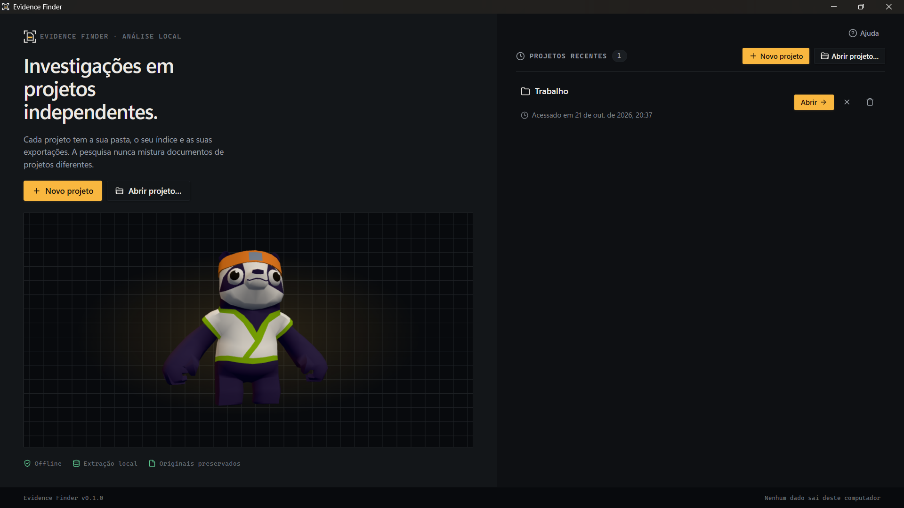
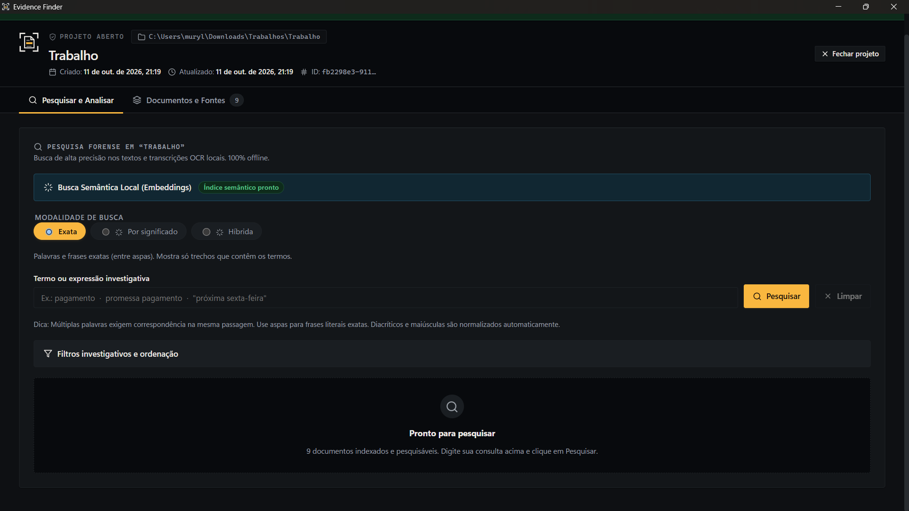
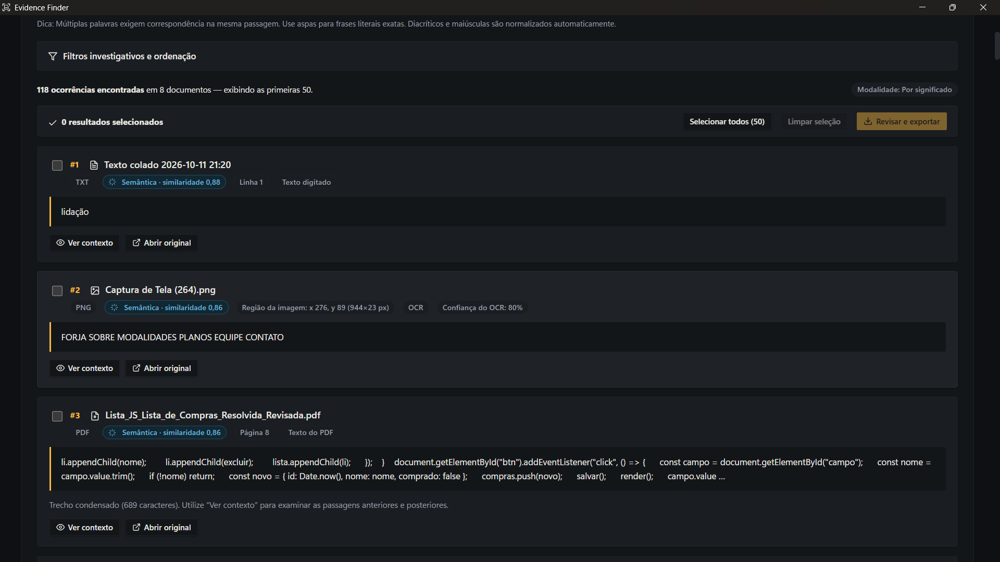
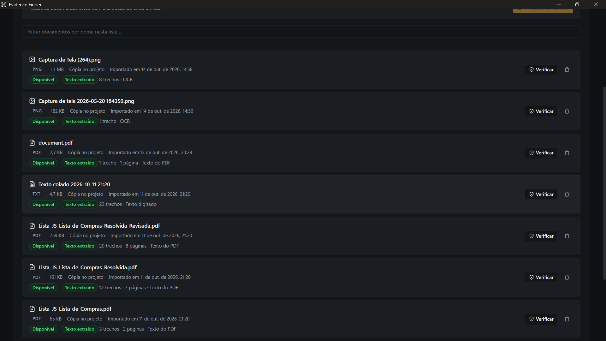
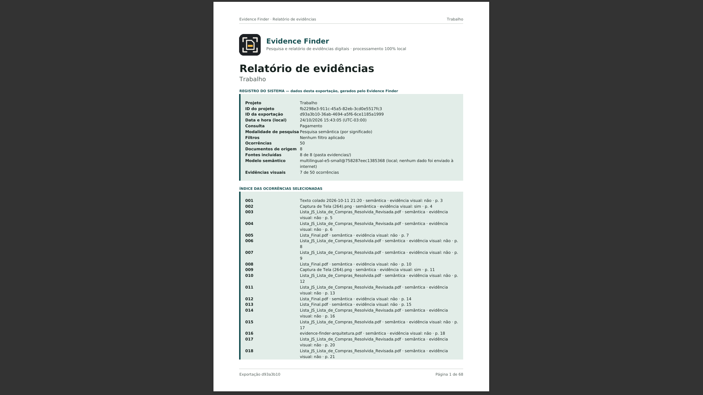
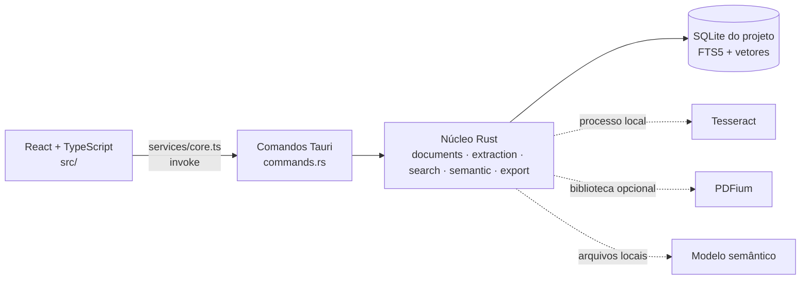

# Evidence Finder

Aplicação desktop para **pesquisar em evidências digitais** (capturas de tela, imagens, PDFs, arquivos TXT e texto copiado) com **processamento local** e exportação de resultados com referência às fontes.




> **Estado do projeto:** versão `0.1.0`, em desenvolvimento. O núcleo foi compilado e testado em **Linux**; a validação em **Windows real**, o **instalador** e os testes de qualidade com o **modelo semântico real** ainda estão **pendentes** (veja [Estado atual e limitações](#estado-atual-e-limitações)). Ainda não há instalador publicado para download.

## O problema

Quem analisa material digital (conversas, prints, PDFs, anotações) costuma ter os arquivos espalhados e precisa reencontrar uma informação **e** saber de onde ela veio. O Evidence Finder reúne os documentos em **projetos independentes**, extrai o texto, permite pesquisar e exporta os trechos escolhidos junto com as fontes e seus hashes.

## Visão geral

- **Projetos independentes:** cada projeto tem a própria pasta, o próprio banco SQLite e o próprio índice; a pesquisa nunca mistura projetos.
- **Importação:** imagens (PNG, JPEG), PDFs, arquivos TXT e texto copiado, em lote, com detecção de duplicatas por SHA-256.
- **Extração de texto:** texto de PDFs e TXT, e **OCR local** (Tesseract) para imagens e PDFs digitalizados.
- **Três modalidades de pesquisa:** exata, por significado (embeddings locais) e híbrida, com filtros, ordenação, contexto e identificação da fonte.
- **Exportação de evidências:** relatório PDF, `manifest.json` e cópia das fontes cujo SHA-256 foi **verificado** na exportação.
- **Sem serviços remotos:** o código não contém cliente de rede nem telemetria (verificado por testes estáticos e por testes com a rede bloqueada em Linux).

Recursos que dependem de componentes externos ou ainda não foram validados em ambiente real estão sinalizados em [Estado atual e limitações](#estado-atual-e-limitações).

## Screenshots

### Projetos

Tela inicial: criar, abrir e retomar projetos recentes. A exclusão de projeto pede confirmação e nunca apaga os arquivos originais.


### Pesquisa

Aba **Pesquisar e Analisar** com as modalidades **Exata**, **Por significado** e **Híbrida**, o estado do índice semântico, os filtros e a ordenação.



### Resultados e seleção

Resultados com formato, página, linha ou região da imagem, método de extração, confiança do OCR e, na busca por significado, a similaridade. Os resultados marcados seguem para **Revisar e exportar**.



### Documentos e fontes

Aba **Documentos e Fontes**: formato, tamanho, modalidade de armazenamento (cópia no projeto ou referência), disponibilidade, estado da extração e o botão **Verificar** (confere o SHA-256).



### Relatório PDF

Primeira página do relatório exportado: dados do projeto e da exportação, consulta, modalidade, modelo semântico e índice das ocorrências.



> As capturas mostram o aplicativo em execução. Elas **não** substituem a validação em Windows registrada como pendente em [`docs/FASE7.md`](docs/FASE7.md).

## Funcionalidades

### Projetos e documentos

- Criar, abrir e listar projetos recentes; exclusão segura de projeto (cópias gerenciadas e banco, nunca os originais).
- Importar vários arquivos de uma vez (PNG, JPEG, TXT, PDF) ou **adicionar texto copiado**.
- Duas modalidades de armazenamento: **copiar para o projeto** (com verificação de integridade) ou **apenas referenciar** o original.
- Detecção de duplicatas por SHA-256; formato conferido pelo conteúdo, não só pela extensão.
- Verificação de disponibilidade (movido, alterado, cópia danificada) e **Verificar** sob demanda.
- Limites: 500 documentos por projeto, 500 MB por arquivo e 5 MB de texto colado. Os limites da extração estão em `src-tauri/src/extraction.rs`.

### Extração de informações

- Texto de PDFs por página (`lopdf`) e de TXT (UTF-8, UTF-16 com BOM, Windows-1252).
- **OCR local** com Tesseract para PNG, JPEG e PDFs digitalizados, com caixas delimitadoras e confiança. **O Tesseract é uma dependência externa** e o idioma `por` é obrigatório.
- Orientação EXIF de fotos JPEG aplicada antes do OCR e do relatório.
- Estados de processamento, falhas por documento (sem interromper o lote) e **Tentar novamente**.

### Pesquisa

| Modalidade | Como funciona |
| --- | --- |
| **Exata** | SQLite FTS5: palavras, combinação de termos e frase exata entre aspas; ignora maiúsculas e acentos. Não depende do modelo semântico. |
| **Por significado** | Embeddings locais (`multilingual-e5-small` via `candle`); só trechos acima de um limiar de similaridade **inicial e não calibrado**. |
| **Híbrida** | Fusão (RRF) entre a lista exata e a semântica; resultados com o termo literal não são descartados por similaridade baixa. |

Filtros por documento, formato e período de importação; ordenação por relevância ou por documento e posição; **Ver contexto** (trechos vizinhos) e **Abrir original** no aplicativo padrão do sistema. A similaridade é um indicador técnico e não confirma fatos.

### Exportação de evidências

1. Marque os resultados desejados (nada é exportado automaticamente).
2. **Revisar e exportar** mostra consulta, filtros, trechos completos e os arquivos que serão copiados.
3. A exportação cria uma pasta nova (nunca sobrescreve):

```text
EvidenceFinder-Exportacao-AAAAMMDD-HHMMSS/
├── relatorio.pdf      relatório com as ocorrências, localização e hashes
├── manifest.json      ocorrências, fontes, hash registrado × hash verificado
└── evidencias/        cópias das fontes verificadas (arquivo_001.ext, ...)
```

O relatório pode incluir **evidência visual** (imagem com o trecho destacado) para imagens e PDFs digitalizados com uma imagem por página. Em PDFs com texto digital isso depende do **PDFium**; quando não é possível, o relatório mantém o texto e registra o motivo.

**Sobre o SHA-256:** ele mostra que o conteúdo é idêntico ao registrado na importação. **Não** comprova autenticidade, autoria, data de criação nem cadeia de custódia formal.

## Tecnologias e arquitetura

| Camada | Tecnologia | Papel |
| --- | --- | --- |
| Interface | React 19, TypeScript (modo estrito), Vite | Telas e componentes; `src/services/core.ts` é a única ponte com o núcleo |
| Casca desktop | Tauri 2, `tauri-plugin-dialog` | Janela, comandos e diálogos nativos (o plugin é usado só pelo lado Rust) |
| Núcleo | Rust | Importação, extração, pesquisa, exportação e regras de segurança |
| Armazenamento | SQLite (`rusqlite`, FTS5) | Metadados, trechos, índice de busca e vetores; um banco por projeto |
| OCR | Tesseract 5 (processo local) | Texto de imagens e PDFs digitalizados; **instalação separada** |
| Leitura de PDF | `lopdf` | Texto de PDFs |
| Evidência visual em PDF (opcional) | PDFium (`pdfium-render`, biblioteca dinâmica) | Localizar termos em PDFs com texto digital |
| Semântica | `candle` + `tokenizers` | Embeddings locais; modelo instalado pelo usuário, nunca baixado pelo app |
| Testes | Vitest, `cargo test`, ESLint | Frontend e núcleo |



A interface não envia caminhos ao núcleo: pastas e arquivos são escolhidos em diálogos nativos abertos pelo Rust e devolvidos como tokens opacos. Ela envia apenas identificadores e tokens.

## Privacidade e segurança

Implementado e coberto por testes:

- **Processamento local**, sem telemetria e sem cliente de rede no código. A suíte de testes passa com a rede bloqueada em Linux.
- Permissões do Tauri mínimas (`capabilities/default.json` sem permissões) e CSP restritiva.
- Validação de nomes, identificadores e caminhos no núcleo; criação sem sobrescrever; gravação em arquivo temporário seguida de verificação de hash.
- Exportação montada em pasta temporária e publicada por renomeação; falhas removem só o que a própria operação criou.
- Os arquivos originais nunca são alterados nem apagados.

Limitações que você precisa conhecer:

- **O armazenamento local não é criptografado:** bancos SQLite, cópias gerenciadas, vetores e exportações ficam legíveis para quem tiver acesso à pasta do projeto. A recomendação atual é usar a criptografia de disco do sistema (por exemplo, BitLocker).
- O funcionamento **offline foi verificado em Linux**; a verificação equivalente no **Windows** (com firewall) continua pendente.
- Não há auditoria profissional de segurança; `cargo audit` e a revisão de licenças das dependências estão pendentes.
- Não protege contra malware nem contra outros usuários com acesso à sua conta ou ao disco.

A avaliação de criptografia e a tabela de segurança completa estão em [`docs/FASE7.md`](docs/FASE7.md).

## Estado atual e limitações

| Situação | Itens |
| --- | --- |
| **Implementado e testado em Linux** | Projetos, importação, extração, OCR (Tesseract real), pesquisa exata, lógica do índice semântico (com gerador de teste), exportação PDF e manifesto, orientação EXIF, PDFium real, execução com rede bloqueada |
| **Implementado, não validado em ambiente real** | Fluxo completo em Windows, `pdfium.dll` no Windows, diálogos nativos, scripts `.bat` e `.ps1` |
| **Pendente** | Testes `real_model_*` com o modelo real e **calibração do limiar** de similaridade; geração e teste do **instalador Windows**; conferência do **PDF em leitor real**; medição de memória e desempenho em Windows e em `release`; **criptografia do armazenamento**; `cargo audit` e revisão de licenças |
| **Sem suporte hoje** | Evidência visual em PDF digitalizado com várias imagens por página; busca por prefixo, sinônimos ou erros de digitação na modalidade exata; interface em outro idioma além do português do Brasil |

O extrator de PDF (`lopdf`) pode juntar linhas em alguns PDFs, o que pode impedir a busca por certas palavras (item 6 das falhas em [`docs/FASE7.md`](docs/FASE7.md)).

A matriz completa de requisitos, as medições e os resultados executados estão em [`docs/FASE7.md`](docs/FASE7.md).

## Instalação

### Para usuários

**Ainda não existe instalador validado nem Release publicada.** O repositório contém o script de empacotamento (`scripts/preparar-distribuicao.ps1`) e um workflow do GitHub Actions (`.github/workflows/build-windows.yml`), mas, segundo a documentação, o script e o instalador **nunca foram executados e testados em Windows**. Variantes, conteúdo, requisitos e a lista de verificações pendentes: [`docs/DISTRIBUICAO.md`](docs/DISTRIBUICAO.md).

Alternativa atual, **para quem aceita um fluxo ainda não validado por completo**: em Windows 10 (1809+) ou 11 com `winget`, extraia o projeto em uma pasta de caminho curto (fora do OneDrive) e execute `INICIAR.bat`. O script instala o que faltar (Node.js, Rust, Ferramentas C++, WebView2, Tesseract com o idioma português e o modelo semântico, cerca de 470 MB), compila o aplicativo e o abre, o que pode levar de 10 a 30 minutos ou mais. Depois de atualizar o código, use `RECOMPILAR.bat`. Em caso de erro, consulte `instalacao-log.txt`.

### Para desenvolvedores

Pré-requisitos:

- [Node.js](https://nodejs.org) LTS (>= 20)
- [Rust](https://rustup.rs) estável recente (a árvore foi compilada com 1.91.1; o `rust-version = "1.77.2"` do `Cargo.toml` não foi verificado)
- Windows: Ferramentas C++ ("Desenvolvimento para desktop com C++") e WebView2. Outros sistemas: veja os [pré-requisitos do Tauri](https://v2.tauri.app/start/prerequisites/)
- Opcionais: Tesseract 5 com `por.traineddata` (OCR) e PDFium (evidência visual de PDFs digitais)

```bash
npm install
npm run app:dev      # aplicativo desktop (Tauri) em modo de desenvolvimento
npm run app:build    # build de produção (instalador NSIS em src-tauri/target/release/bundle/)
```

`npm run dev` inicia **somente o frontend no navegador**. Nesse modo o núcleo Rust não existe e a interface mostra um aviso; use `npm run app:dev` para o aplicativo completo.

#### OCR e modelo semântico

O Tesseract e o modelo **não vêm no repositório** e o aplicativo nunca baixa nada. Sem o Tesseract, TXT, texto colado e PDFs com texto continuam funcionando; imagens e PDFs digitalizados informam "OCR indisponível". Sem o modelo, a busca exata funciona normalmente. Para instalar o modelo em desenvolvimento, use `scripts/instalar-modelo.ps1` (veja [`docs/FASE7.md`](docs/FASE7.md)).

## Testes e qualidade

```bash
npm run typecheck    # TypeScript estrito
npm run lint         # ESLint
npm run test         # Vitest (frontend)
npm run test:rust    # cargo test (núcleo)
npm run check        # todos os anteriores
```

Resultado registrado em [`docs/FASE7.md`](docs/FASE7.md) (Linux, Ubuntu 24.04, Rust 1.91.1, Tesseract em português, rede bloqueada): **82 testes do frontend** e **258 testes Rust** passam, sem falhas. **10 testes Rust ficam `ignored`** por dependerem de recursos externos (Tesseract, PDFium, modelo semântico, benchmark) e os 4 testes do **modelo semântico real não foram executados**. Esses números são o registro daquela rodada, não uma nova execução.

## Estrutura do repositório

```text
src/             interface React (pages, components, hooks, services, lib)
src-tauri/       casca Tauri e núcleo Rust (src/), testes e fontes do relatório
scripts/         instalação e empacotamento para Windows (PowerShell)
docs/            documentação técnica e screenshots
.github/         workflow de geração do instalador
```

## Documentação complementar

- [`docs/FASE7.md`](docs/FASE7.md): estado real de verificação, busca semântica, evidências visuais, desempenho, segurança e matriz de requisitos.
- [`docs/DISTRIBUICAO.md`](docs/DISTRIBUICAO.md): variantes do instalador, empacotamento, licenças e verificações pendentes em Windows.
- [`docs/REDESIGN.md`](docs/REDESIGN.md): registro histórico do redesign da interface e do relatório (escrito antes das verificações da Fase 7).

## Licença

O repositório **não declara uma licença** para o código do aplicativo. As dependências e componentes de terceiros têm licenças próprias (por exemplo, a fonte DejaVu em [`src-tauri/assets/fonts/LICENSE-DejaVu.txt`](src-tauri/assets/fonts/LICENSE-DejaVu.txt)); veja [`docs/DISTRIBUICAO.md`](docs/DISTRIBUICAO.md).
